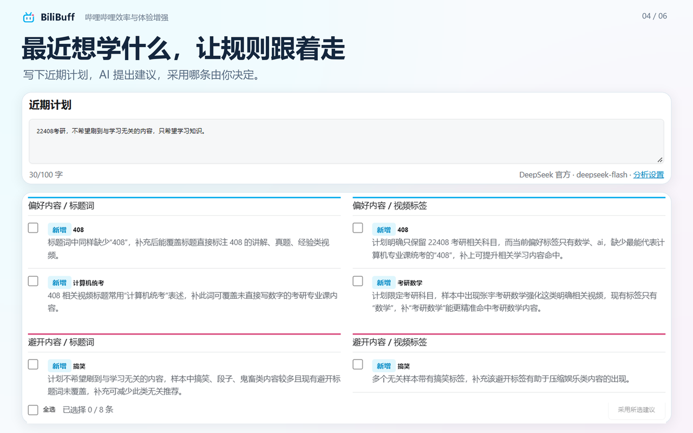

<!-- 用轻松的产品介绍说明使用场景、主要功能和上手方式。 -->

  

# BiliBuff - 哔哩哔哩｜B站效率与体验增强插件

上B站学东西，加个Buff更顺手。

  
  
  
  
  

  <a href="docs/使用指南/扩展安装与迁移.md#安装">安装指南</a> ·
  <a href="docs/README.md">使用文档</a> ·
  <a href="https://github.com/emmm1245/BiliBuff/issues">反馈问题</a>

**BiliBuff** 是面向 B 站学习与日常浏览的**效率**与**体验**增强插件。推荐筛选、屏蔽视频、留白首页、观看统计，加上按需使用的 AI计划分析、AI视频助手和AI评论区速读，让找内容、看视频、读评论超丝滑。

当前chrome扩展商店已发布，edge用户也可通过该链接安装扩展
<a href="https://chromewebstore.google.com/detail/lapdedhlnlgldnfbedabdpfabhimkdok?utm_source=item-share-cb" style="color:pink;">BiliBuff - 哔哩哔哩｜B站效率与体验增强插件</a>

edge扩展商店即将发布，敬请期待

## 推荐可以挑一挑

设置里有“想多看”和“想少看”两个区，填几个词就能开始。

比如最近在学摄影，可以把`摄影` `构图`放进想多看；总被`剧透`和`抽奖`带跑，就把它们放进想少看。扩展会根据视频标题和标签判断：
喜欢的加上高亮，不想看的盖住封面，首页和播放页旁边的推荐都能照顾到。

日常可以保留没匹配到的推荐，顺便发现点新东西；临近考试、赶项目，或者今天实在经不起诱惑，就打开“只看偏好的内容”，让推荐范围再收紧一点。

挡住的视频可以临时查看。偶尔想开盲盒，点一下就行。

## 首页太热闹，留点白

推荐广告、首页轮播、直播、番剧……统统都可以屏蔽。

想干脆点？开启**留白模式**，首页只留下搜索框，还你纯净体验。

## 规则懒得想，AI 搭把手

有时候只知道“最近想认真学点东西”，具体填什么词，一时半会还真说不上来。

在 **“AI 计划分析”** 里写下近期计划，等观看和屏蔽记录积攒一定数量后，让AI分析。AI会给出筛选规则的增删词条的建议及理由；信息不够时，也可能问个你小问题，把方向搞清楚。

建议出来后，挑自己认可的再采用。觉得它说得不对不好，放着就好。

另外还有一个 **AI 复核** 功能：对已经按偏好放行的“推荐视频”，再评估它和近期计划是否相关。比如标题碰巧带着“学习”，内容却未必是你眼下想学的那一类，这种就让AI复核帮你搞定屏蔽。

## 评论太多，先速读

**“评论区速读”** 以可拖动悬浮窗呈现，翻看评论时也能保留分析在旁边。展开后，AI 会整理讨论与观点，挑出有价值的评论，可精确定位楼层。

不想用自己的模型服务，也能把全部或筛选后的评论复制、下载为带回复关系和来源链接的文本，交给其他网页AI。

## 视频很长，抓重点

视频页右侧的“BiliBuff视频助手”提供字幕、总结、章节、问答和下载五个分页。字幕可以搜索、点击定位、跟随播放，也能复制或导出成纯文本、带时间戳文本和字幕文件。

AI根据视频内容总结，并提供引用回到关键视频位置。复制或导出包含完整详情，已有文字总结仍可阅读。

AI生成章节。标记疑似广告部分；章节按真实字幕时间跳转，视频口播广告可自动跳过。

围绕当前视频提问，并提供引用回到关键视频位置。

提供部分视频下载服务。

## 看了什么，留个账本

设置页能看到累计高亮、屏蔽和观看的数量。

至于播放时有没有认真听，还是你自己最清楚~

## 装好插件后，从几个词开始

点击浏览器工具栏里的扩展图标，或 B 站页面右下角的“BiliBuff 设置”，就能打开设置页。

1. 在“想多看”里填几个最近关心的主题。
2. 在“想少看”里填几个经常让你跑偏的词。
3. 回 B 站看看效果，perfect。

主题有深/浅色，跟随系统。规则、计划、记录保存在本机，可导出备份，导入其他浏览器。

本项目为浏览器扩展，支持 Chrome 和 Edge。

上B站学东西，加个Buff更顺手~

## 开源许可

本项目采用 [Apache License 2.0](LICENSE) 开源许可证。
